## Evidência A

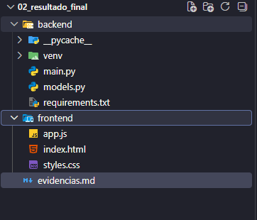

## Evidência B

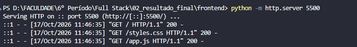
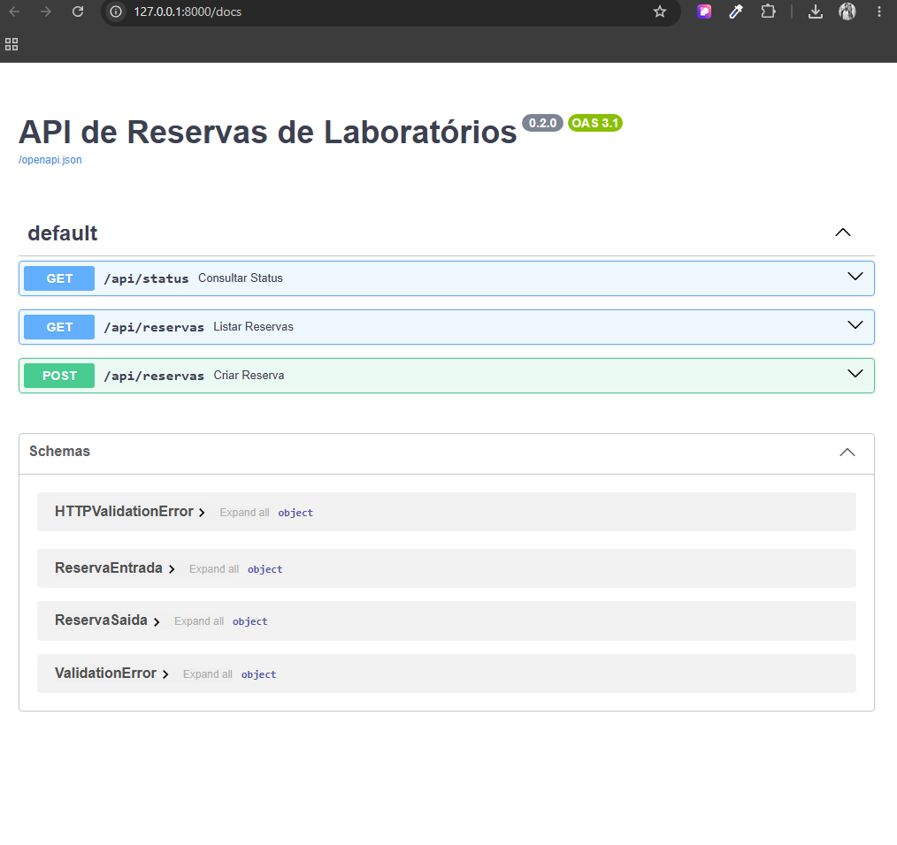
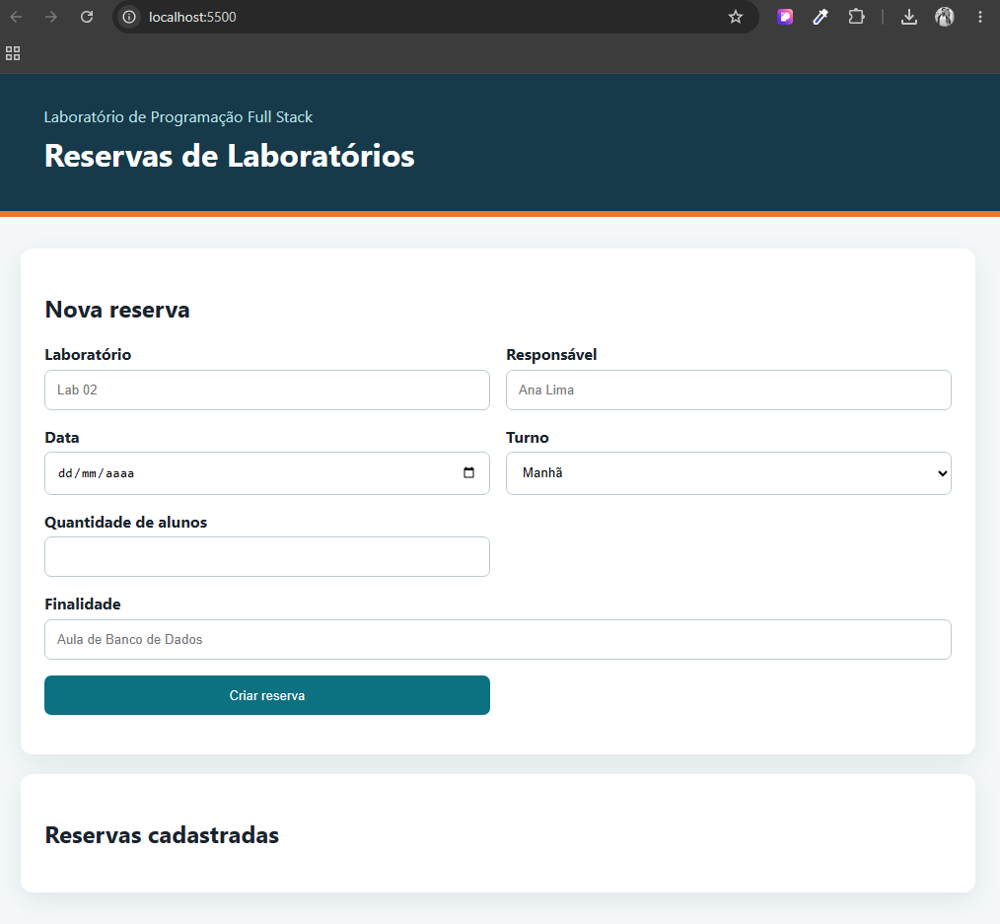

## Evidência C

• Request URL; `http://127.0.0.1:8000/api/reservas`

• Request Method; `GET`

• Status Code 201; `200 OK`

• Request Payload; `127.0.0.1:8000`

• Response. `strict-origin-when-cross-origin`

• loc: `"loc": [`
`"body",`
`"turno"`
`]`

• msg: `"msg": "Input should be 'manha', 'tarde' or 'noite'"`

• input: `"input": "madrugada"`
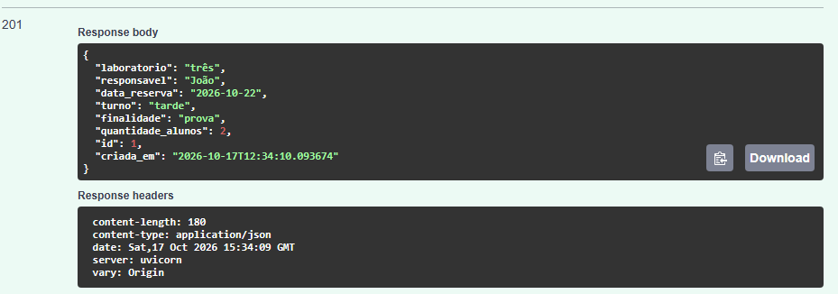
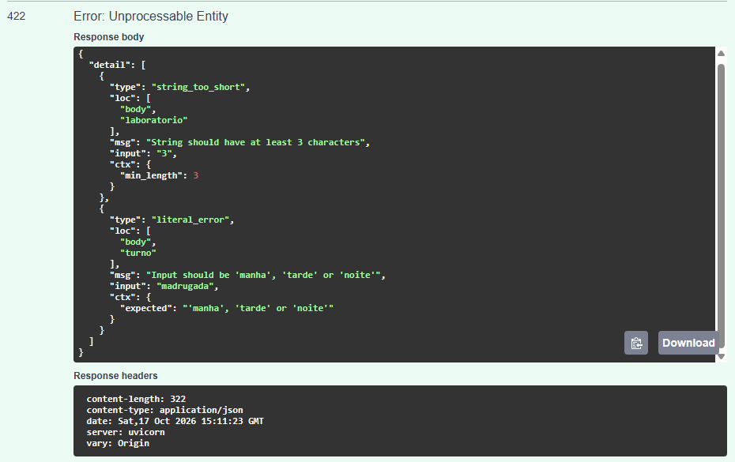

## Evidencia E Testar a Solução

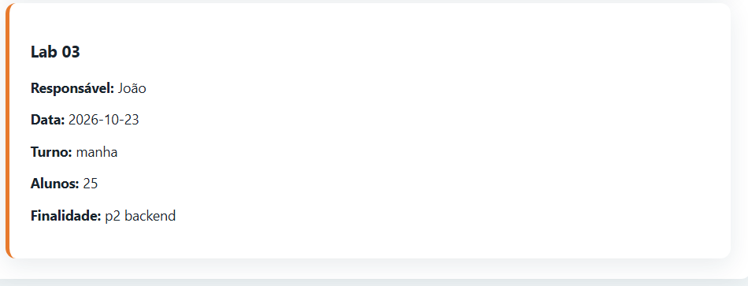
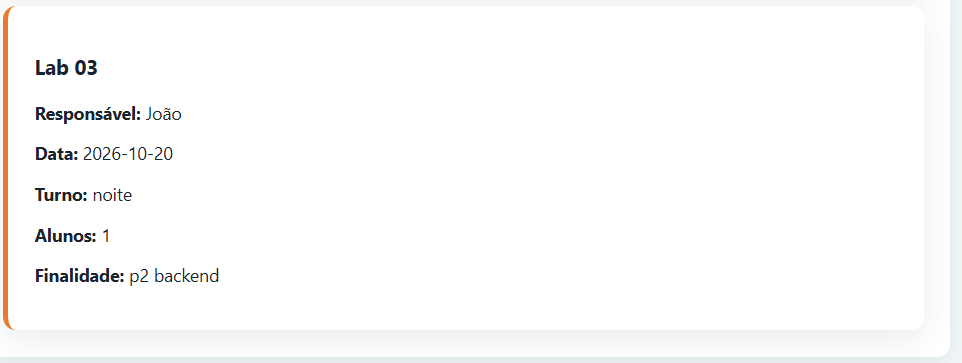
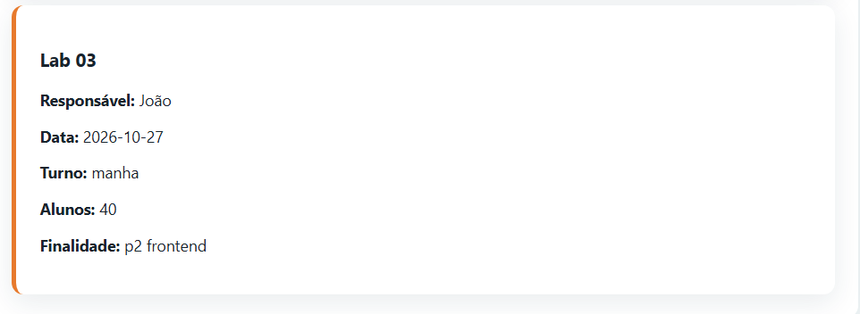
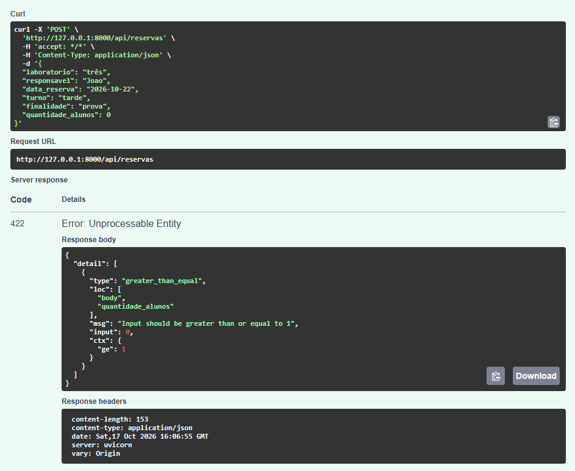
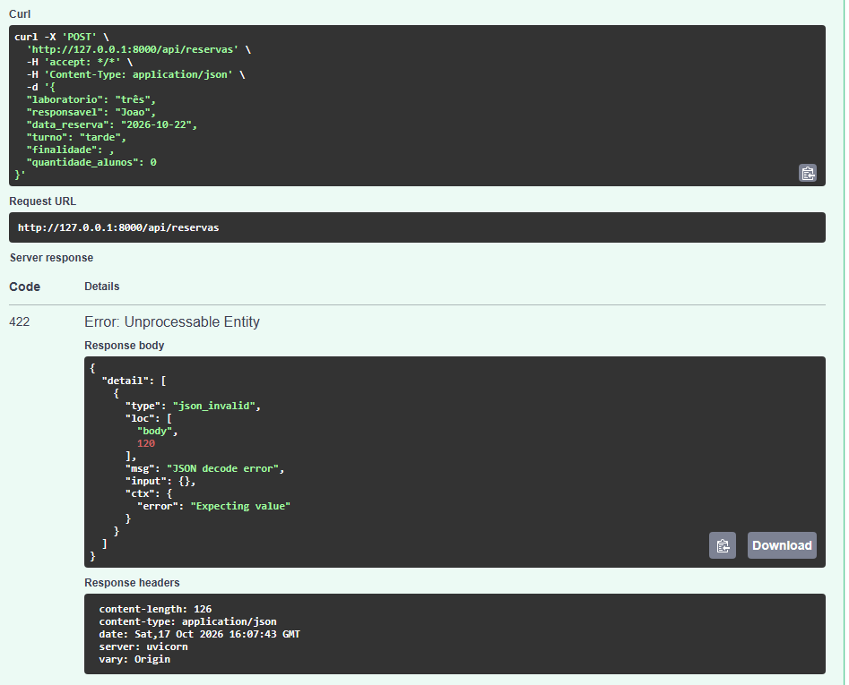
